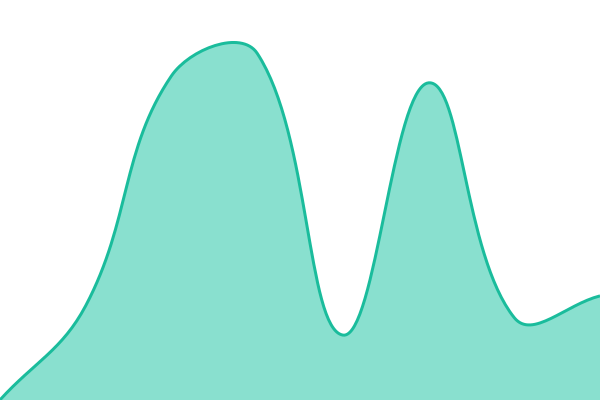

# [📈 Live Status](https://demo.upptime.js.org): <!--live status--> **🟩 All systems operational**

This repository contains the open-source uptime monitor and status page for [Upptime](https://upptime.js.org), powered by [Upptime](https://github.com/upptime/upptime).

With [Upptime](https://upptime.js.org), you can get your own unlimited and free uptime monitor and status page, powered entirely by a GitHub repository. We use [Issues](https://github.com/upptime/upptime/issues) as incident reports, [Actions](https://github.com/Voice-Mate/status-page/actions) as uptime monitors, and [Pages](https://demo.upptime.js.org) for the status page.

<!--start: status pages-->
<!-- This summary is generated by Upptime (https://github.com/upptime/upptime) -->
<!-- Do not edit this manually, your changes will be overwritten -->
<!-- prettier-ignore -->
| URL | Status | History | Response Time | Uptime |
| --- | ------ | ------- | ------------- | ------ |
|  [Voice Mate website](https://voicemate.us) | 🟩 Up | [voice-mate-website.yml](https://github.com/Voice-Mate/status-page/commits/HEAD/history/voice-mate-website.yml) | 

 840ms
     
 | 

<a href="https://status.voicemate.nl/history/voice-mate-website">100.00%</a>
    

|  [Voice Mate app and API](https://voicemate.us/healthcheck) | 🟩 Up | [voice-mate-application-api.yml](https://github.com/Voice-Mate/status-page/commits/HEAD/history/voice-mate-application-api.yml) | 

 437ms
     
 | 

<a href="https://status.voicemate.nl/history/voice-mate-application-api">100.00%</a>
    

|  [Database](https://voicemate.us/databasestatus) | 🟩 Up | [voice-mate-database.yml](https://github.com/Voice-Mate/status-page/commits/HEAD/history/voice-mate-database.yml) | 

 432ms
     
 | 

<a href="https://status.voicemate.nl/history/voice-mate-database">100.00%</a>
    

|  [Call processing and notifications](https://voicemate.us/pipelinestatus) | 🟩 Up | [voice-mate-background-processing.yml](https://github.com/Voice-Mate/status-page/commits/HEAD/history/voice-mate-background-processing.yml) | 

 449ms
     
 | 

<a href="https://status.voicemate.nl/history/voice-mate-background-processing">100.00%</a>
    

|  [Phone calls and texts (Twilio)](https://voicemate.us/twiliostatus) | 🟩 Up | [phone-call-handling-twilio.yml](https://github.com/Voice-Mate/status-page/commits/HEAD/history/phone-call-handling-twilio.yml) | 

 1634ms
     
 | 

<a href="https://status.voicemate.nl/history/phone-call-handling-twilio">100.00%</a>
    

|  [Payments (Stripe)](https://voicemate.us/stripestatus) | 🟩 Up | [payments-stripe.yml](https://github.com/Voice-Mate/status-page/commits/HEAD/history/payments-stripe.yml) | 

 871ms
     
 | 

<a href="https://status.voicemate.nl/history/payments-stripe">100.00%</a>
    

|  [Voice AI (Vapi)](https://status.vapi.ai) | 🟩 Up | [ai-powered-voice-processing-services-vapi.yml](https://github.com/Voice-Mate/status-page/commits/HEAD/history/ai-powered-voice-processing-services-vapi.yml) | 

 1427ms
     
 | 

<a href="https://status.voicemate.nl/history/ai-powered-voice-processing-services-vapi">100.00%</a>
    

<!--end: status pages-->

[**Visit our status website →**](https://demo.upptime.js.org)

## 📄 License

- Powered by: [Upptime](https://github.com/upptime/upptime)
- Code: [MIT](./LICENSE) © [Anand Chowdhary](https://anandchowdhary.com), supported by [Pabio](https://pabio.com)
- Data in the `./history` directory: [Open Database License](https://opendatacommons.org/licenses/odbl/1-0/)
